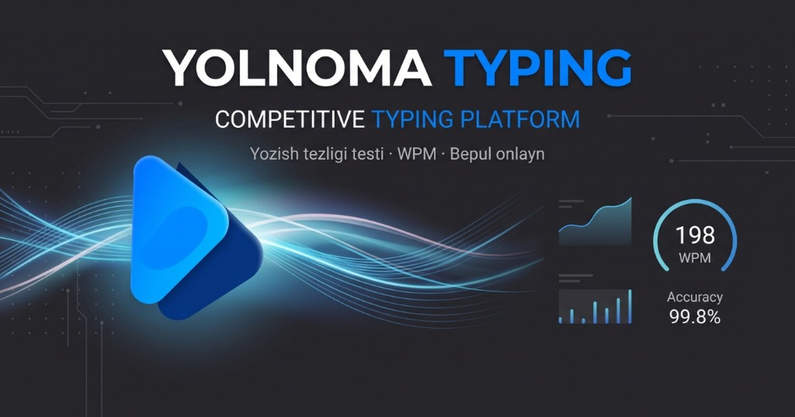

<div align="center">

# ⚡ Yolnoma Typing — Klaviaturada Tez Yozish Platformasi
**Oʻzbekistonda 10 barmoqli tez yozish madaniyatini rivojlantiruvchi №1 Milliy Platforma**

[](https://www.yolnoma.uz)
[](https://react.dev/)
[](https://www.typescriptlang.org/)
[](https://tailwindcss.com/)
[](https://firebase.google.com/)
[](https://www.yolnoma.uz)

<p align="center">
  
</p>

</div>

---

## 📌 Loyiha Haqida

**Yolnoma Typing** — bu klaviaturada koʻr-koʻrona 10 barmoq bilan tez va aniq yozishni oʻrgatuvchi, milliy reyting tizimiga ega zamonaviy interaktiv platforma.

Platforma foydalanuvchilarga nafaqat yozish tezligini (WPM va CPM) oʻlchash, balki real vaqt rejimida boshqa foydalanuvchilar bilan 1v1 janglar (Speedway Battle) oʻtkazish, klaviaturaga qaramasdan yozish darslarini oʻzlashtirish va Oʻzbekiston milliy reytingida eng yuqori pogʻonalarga koʻtarilish imkonini beradi.

### 🌟 Asosiy Imkoniyatlar:
- ⚡ **Tezlik Testlari**: 15, 30, 60 va 120 soniyalik hamda soʻz soniga asoslangan aniq WPM va CPM tahlili.
- 🌍 **125+ Jahon Tillari**: Oʻzbek tili (Lotin va Kirill alifbolari), Ingliz, Rus, Qoraqalpoq va 120 dan ortiq dunyo tillari.
- 🏁 **Jonli 1v1 Speedway Battle**: Doʻstlar va tasodifiy raqiblar bilan real vaqt rejimida klaviatura poygasi.
- 📚 **10 Barmoq Interaktiv Darslari**: Klaviaturaga qaramasdan koʻr-koʻrona yozish metodikasi.
- 🛡️ **Intellektual Anti-Cheat Tizimi**: Nusxalash (paste), robotlar, skriptlar va soxta bosishlarni aniqlovchi xavfsizlik dvigateli.
- 🏆 **Milliy Reyting (Leaderboard)**: Oʻzbekistonning eng tezkor klaviatura ustalari roʻyxati.
- 📊 **Shaxsiy Tahlil va Statistika**: Harflardagi xatoliklar tahlili, oʻsish grafigi va yutuqlar (achievements).
- 🎨 **Zamonaviy Cyber / Minimalist Dizayn**: Koʻzni charchatmaydigan ergonomik qorongʻi mavzular va moslashuvchan animatsiyalar.

---

## ⚖️ MUALLIFLIK HUQUQI VA KODNI OʻGʻIRLASHDAN HIMOYA (COPYRIGHT & PROPRIETARY NOTICE)

> [!CAUTION]
> ### 🛑 QATʼIY OGOHLANTIRISH: KODNI OʻGʻIRLASH, KOʻCHIRISH VA KLONLASH TAQIQLANADI!
> Ushbu platformaning barcha manba kodlari, algoritmlari, dizayni, arxitekturasi va unga tegishli materiallar **intellektual mulk** hisoblanadi va qonun bilan toʻliq himoyalangan.

### 🇺🇿 Oʻzbekiston Respublikasi Qonunchiligi Boʻyicha:
1. **Mualliflik huquqi daxlsizligi**: Ushbu dasturiy taʼminot kodi, uning frontend va backend mantigʻi, Anti-Cheat algoritmlari va interfeysi mualliflik huquqi obyektidir.
2. **Qatʼiyan man etiladi**:
   - Manba kodlarini toʻliq yoki qisman ruxsatsiz koʻchirish (nusxalash);
   - Loyihani klonlab boshqa domenda, serverda yoki shaxsiy nom ostida noqonuniy ishga tushirish;
   - Kodni, algoritmlarni yoki dizayn elementlarini muallifning rasmiy yozma ruxsatisiz tijoriy yoki notijoriy maqsadlarda oʻzlashtirish;
   - Mualliflik belgilarini, brend logotiplarini yoki havolalarni oʻzgartirish/oʻchirish.
3. **Qonuniy javobgarlik**: Oʻzbekiston Respublikasining **"Mualliflik huquqi va turdosh huquqlar toʻgʻrisida"**gi Qonuni (730-II-son) hamda Oʻzbekiston Respublikasi Jinoyat kodeksi va Maʼmuriy javobgarlik toʻgʻrisidagi kodeksiga muvofiq, intellektual mulkni oʻgʻirlash va mualliflik huquqini buzish qonuniy javobgarlik (jarima, zararni undirish va jinoiy javobgarlik)ga sabab boʻladi.

---

### 🌐 International Copyright & Legal Terms (DMCA Protected):
**Copyright © 2024–2026 Yolnoma Typing (yolnoma.uz). All Rights Reserved.**

- **Proprietary Software**: All rights, title, and interest in and to this software, including without limitation all software code, scripts, styles, logic, anti-cheat detection methods, UI/UX designs, and related documentation are the exclusive proprietary property of the author/owner.
- **Strict Prohibition of Piracy**: Unauthorized copying, duplication, scraping, cloning, distribution, modification, public display, reverse engineering, decompilation, or creating derivative works of any portion of this codebase is **STRICTLY PROHIBITED**.
- **Enforcement & DMCA**: Any unauthorized deployments, copied repositories, or cloned services will be immediately subjected to **DMCA Takedown Notices**, domain registrar blacklisting, server host abuse terminations, and appropriate legal action for monetary damages and copyright infringement.

---

## 🛠️ Texnologiyalar Steki

| Qatlam | Texnologiyalar |
|---|---|
| **Frontend** | React 19, TypeScript, Vite, Tailwind CSS v4, Lucide Icons, Canvas Confetti |
| **Backend & API** | Node.js / Express, Vercel Edge Serverless Functions |
| **Maʼlumotlar Bazasi** | Firebase Realtime Database, Cloud Firestore |
| **Xavfsizlik & Anti-Cheat** | Keystroke Dynamics Engine, Rate Limiting, Sliding Window Token Guard |
| **SEO & OpenGraph** | Per-route prerender generator, Meta OG Banner Suite |

---

## 💻 Loyihani Lokal Ishga Tushirish (Local Development)

Ushbu loyiha faqat ruxsat berilgan ishlab chiquvchilar uchun quyidagicha ishga tushiriladi:

```bash
# 1. Repozitoriyga kiring
cd yolnoma-typing

# 2. Bog'liqliklarni o'rnating
npm install

# 3. Muhit o'zgaruvchilarini sozlang
cp .env.example .env

# 4. Mahalliy ishlab chiqish serverini ishga tushiring
npm run dev

# 5. Ishlab chiqarish (Production) uchun yig'ish
npm run build
```

---

## 📞 Muallif va Bogʻlanish

Loyihaga oid savollar, ruxsatnomalar, takliflar yoki hamkorlik masalalari boʻyicha:

- 👤 **Asoschi va Muallif**: Elbek Qoriyev (Qoriyev Elbek)
- 🌐 **Rasmiy Veb-sayt**: [https://www.yolnoma.uz](https://www.yolnoma.uz)
- 📩 **Telegram / Aloqa**: Saytning rasmiy qoʻllab-quvvatlash va aloqa boʻlimi orqali

---

<div align="center">
  <b>© 2024–2026 Yolnoma Typing. Barcha huquqlar qonun bilan himoyalangan.</b><br>
  <i>Hurmat bilan, Yolnoma jamoasi.</i>
</div>
